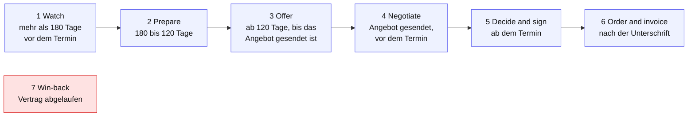
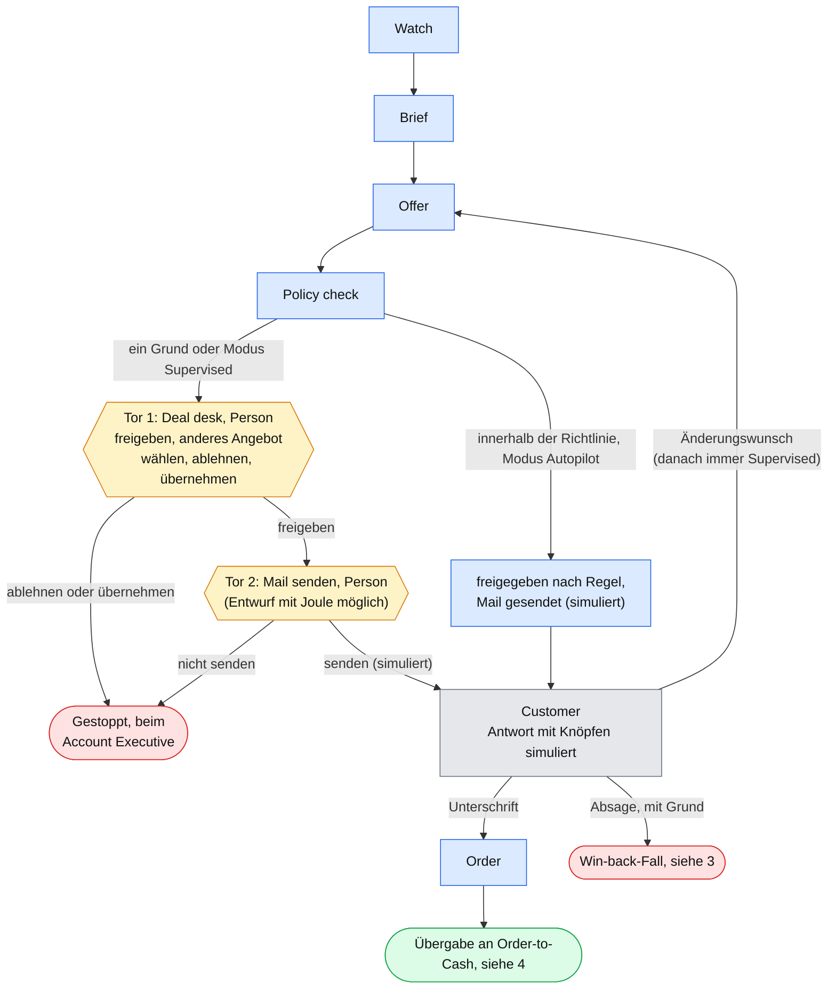
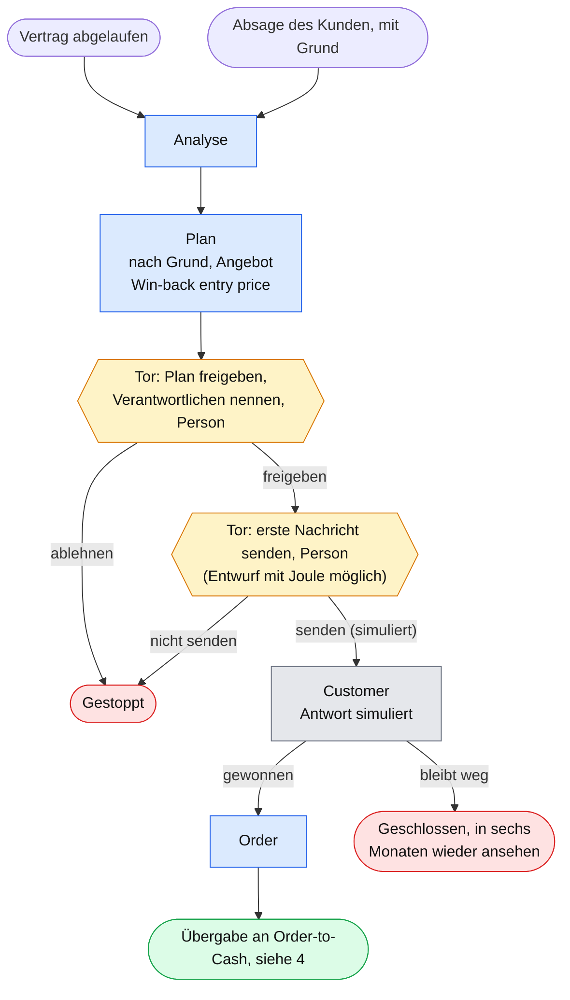
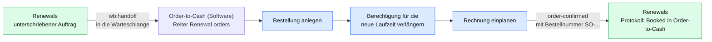

# Renewal-Prozess: die Landkarte

Stand: 13.11.2026, `main` auf `35e3758`. Gelesen im Code (`examples/renewals/logic.js`, `examples/renewals/index.html`, `examples/order-to-cash-software/index.html`) und in `docs/renewals-autopilot.md`. **Nicht in der App durchgeklickt.** Alle Kunden und Zahlen im Space sind erfunden.

## Auf einen Blick

Der Renewal-Prozess ist heute in **drei Schrittmodellen** und **zwei weiteren Abläufen** abgebildet. Sie liegen im Space `renewals`, die Übergabe im Space `order-to-cash-software`.

| Ebene | Wozu | Schritte | Wie umgesetzt |
|---|---|---|---|
| **Phasen** (Reiter "Renewal process") | Jeder Vertrag wird einer Phase zugeordnet | 7: Watch, Prepare, Offer, Negotiate, Decide and sign, Order and invoice, Win-back | gerechnet aus Daten (`phaseOf`), nichts wird bedient |
| **Stufen von Hand** (Detailfenster) | Eine Person markiert den Fortschritt | 5: Detected, Prepared (by you), Offer approved, Sent, Signed | Knöpfe, nur im Speicher |
| **Autopilot** (Reiter "Autopilot") | Der Ablauf läuft selbst, Personen entscheiden an Toren | 8: Watch, Brief, Offer, Policy check, Deal desk, Send, Customer, Order | Zustandsmaschine (`apStart`, `apAct`), mit Protokoll |
| **Win-back** | Ein abgelaufener oder abgesagter Vertrag wird ein eigener Fall | 6: Analyse, Plan, Plan approval, Reach out, Customer, Order | Zustandsmaschine (`wbStart`, `wbAct`), mit Protokoll |
| **Übergabe an Order-to-Cash** (Space `order-to-cash-software`, Reiter "Renewal orders") | Nach der Unterschrift wird der Auftrag gebucht | 3: Bestellung anlegen, Berechtigung verlängern, Rechnung einplanen | Übergabe per `wb:handoff`, Bestätigung `order-confirmed` zurück |

Dazu kommen Hilfen, die keine Schritte sind: Gesundheit aus Signalen, Angebotsalternativen mit Haltequote, die Aktionsliste mit 13 Kennungen, das Briefing durch den Agenten und der Gmail-Entwurf mit Joule.

**Legende der Diagramme:** blau = der Autopilot arbeitet, gelb = eine Person entscheidet (ein Tor), grau = der Kunde (im Space mit Knöpfen simuliert), grün und rot = Ende.

## 1. Die sieben Phasen

Die Phase wird **berechnet**, aus den Tagen bis zum Entscheidungstermin, dem Angebot und der Stufe. Der Entscheidungstermin ist das Vertragsende minus die Kündigungsfrist.

Regeln im Code, in dieser Reihenfolge: abgelaufen heißt Win-back; Stufe "Signed" heißt Order and invoice; ein Angebot (oder die Stufe "Sent") heißt Negotiate, ab dem Termin Decide and sign; sonst nach Tagen: über 180 Watch, über 120 Prepare (solange die Stufe unter "Prepared" liegt), sonst Offer. **Im Verzug** heißt: Das Angebot müsste 90 Tage vor dem Termin vorliegen und fehlt.

## 2. Der Autopilot

Der Autopilot geht die Schritte allein durch und hält an **Toren**, wenn eine Person entscheiden muss. Eine Richtlinie entscheidet: Unter 30.000 EUR im Jahr, ohne Warnsignal und mit einem Angebot im Vertrags-Cap läuft ein Fall im Modus "Autopilot" ohne Person bis zur Antwort des Kunden. Im Modus "Supervised" gibt immer eine Person frei und sendet.

- Der Schritt **Brief** ist ein **regelbasierter Text** aus den Signalen und den Hebeln, nicht das Briefing des Agenten.
- Jede Aktion steht im **Protokoll** mit dem Handelnden (Autopilot, Person, Customer). Kennzahlen: wartet auf dich, beim Kunden, fertig, Schritte Autopilot gegen Person.
- Ein Änderungswunsch baut das Angebot erneut aus den Optionen. Eine Person prüft es am Tor und wählt bei Bedarf ein anderes.

## 3. Win-back

Ein Win-back ist ein **eigener Fall**. Er entsteht, wenn ein Vertrag **abgelaufen** ist (beim Start des Autopiloten) oder wenn der Kunde **absagt** (dann mit dem genannten Grund: Preis, Wettbewerber, Umfang, Budget oder unbekannt).

- Das Angebot ist der "Win-back entry price" aus den Optionen, sonst 15 % unter dem heutigen Preis für 12 Monate.
- Die **Erinnerung nach 14 Tagen** ist nur ein Text im Protokoll, kein Scheduler-Job.

## 4. Übergabe an Order-to-Cash

Nach einer Unterschrift (Renewal) oder einem gewonnenen Win-back geht der Auftrag in die **Warteschlange** des Space `order-to-cash-software` (`wb:handoff`, ohne den Space zu öffnen). Dort bucht der Reiter "Renewal orders" in drei Schritten und meldet die Buchung zurück.

Die Bestätigung wird nur angenommen, wenn sie von `order-to-cash-software` kommt, die Bestellnummer die Form `SO-` plus Zahl hat und der Fall noch nicht gebucht ist.

## 5. Wie die Modelle zusammenhängen

Die Zuordnung ist eine **Lesehilfe**, im Code sind die Modelle nur über die **Stufe** verbunden: Der Autopilot setzt die Stufe (nie unter die, die eine Person gesetzt hat), und die Phase wird aus Stufe und Terminen berechnet.

| Phase | Autopilot-Schritt | Stufe von Hand |
|---|---|---|
| 1 Watch | Watch | Detected |
| 2 Prepare | Brief | Prepared |
| 3 Offer | Offer, Policy check, Deal desk | Offer approved |
| 4 Negotiate | Send, Customer | Sent |
| 5 Decide and sign | Customer: Unterschrift | Signed |
| 6 Order and invoice | Order, danach die drei Schritte in Order-to-Cash | |
| 7 Win-back | die sechs Win-back-Schritte | |

## 6. Was echt ist und was simuliert

| | |
|---|---|
| **Gerechnet auf der Seite** | Gesundheit und Signale, Phase, Angebotsalternativen mit Haltequote und Lebenswert, die Richtlinie unter 30.000 EUR, die Aktionsliste, Zahlen in "Today" |
| **Echt über den Agenten** | das **Briefing** (Prompt ohne Werkzeuge, Antwort als Entwurf) und der **Gmail-Entwurf** ("Draft with Joule", nur ein Entwurf an die eigene Adresse, nie gesendet) |
| **Simuliert** | Senden an den Kunden, Antwort des Kunden, Unterschrift, die Buchung in Order-to-Cash, die Erinnerung nach 14 Tagen |
| **Speicher** | nur im Arbeitsspeicher der Seite und des Hosts, **geht beim Schließen der App verloren** |

## 7. Was fehlt und was als Nächstes möglich ist

- **Dauerhafter Speicher.** Fälle, Protokolle, Stufen und Briefings gehen mit der App verloren. **Idee von Hans-Peter (13.11.2026): Supabase als Speicher nutzen.** Das ist ein eigener Schritt mit Entscheidungen (was gespeichert wird, wer was sieht, Migration von Hand, Anbindung über den Hauptprozess), noch nicht ausgearbeitet.
- **Echtes Senden, Signieren und Buchen.** Heute alles simuliert.
- **Co-Terming** (Verträge eines Kunden auf ein gemeinsames Datum ziehen), **Zufriedenheit (CSAT) als Churn-Signal** und **Teil- gegen Gesamt-Churn je Kunde** (siehe `docs/renewals-konzept.md`).
- **Echte Identität.** "Person" ist der Verantwortliche des Vertrags, es gibt keine Anmeldung.
- **Zwei parallele automatische Wege** unter 30.000 EUR: der Schalter "Automatic renewal" und der Autopilot, beide simulieren das Senden. Das ist eine Entscheidung über das Produkt.
- **Erinnerungen** (Angebotsgültigkeit, Win-back nach 14 Tagen) als Scheduler-Job.

## Wo es im Code steht

| Was | Wo |
|---|---|
| Phasen, Regeln, Signale, Optionen, Aktionen | `examples/renewals/logic.js` (`PHASES`, `phaseOf`, `signals`, `options`, `actions`) |
| Autopilot | `examples/renewals/logic.js` (`AP_STEPS`, `apPolicy`, `apRun`, `apStart`, `apAct`, `apSummary`) |
| Win-back | `examples/renewals/logic.js` (`WB_STEPS`, `wbStart`, `wbRun`, `wbAct`) |
| Seite, Zustand, Übergabe | `examples/renewals/index.html` (`apSync`, `apHandOver`, `wbHandOver`, `apConfirmed`) |
| Renewal orders | `examples/order-to-cash-software/index.html` (`RSTEPS`, `cleanOrder`) |
| Briefing | `src/renewals-bridge.ts`, `examples/renewals/index.html` (`briefPrompt`) |
| Ausführliche Beschreibung | `docs/renewals-autopilot.md`, `docs/renewals-briefing-konzept.md`, `docs/renewals-today-konzept.md` |

## Nicht geprüft

- Die Karte beruht auf dem Code auf `main` (`35e3758`), nicht auf einem Durchlauf in der App. Wenn ein anderes Fenster den Code ändert, kann sie veralten.
- Die Diagramme sind von Hand aus dem Code abgeleitet. Die Zuordnung der Modelle in Abschnitt 5 ist meine Lesehilfe.
- Ob die Diagramme in jedem Betrachter gleich aussehen, ist nicht geprüft (GitHub zeigt Mermaid an, ein anderer Markdown-Betrachter vielleicht nicht).
